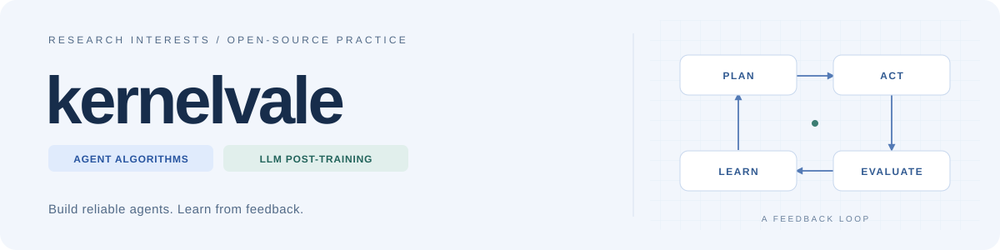

<picture>
  <source media="(prefers-color-scheme: dark)" srcset="https://raw.githubusercontent.com/kernelvale/kernelvale/main/assets/cover-dark.svg">
  
</picture>

### 让 Agent 可靠地行动，让模型从反馈中进步。

你好，我是 **kernelvale**。方向是 **Agent 算法 / 大模型后训练（LLM Post-training）**，关注工具使用、多 Agent 协作与反馈驱动的能力改进。目前的公开实践集中在 **Agent 运行时可靠性、问题复现与回归验证**。

[研究兴趣](#research-interests) · [开源贡献](#open-source-contributions) · [Agent 实践](#agent-in-practice) · [精选项目](#selected-projects) · [全部仓库](https://github.com/kernelvale?tab=repositories)

## Research Interests · 研究兴趣

| 方向 | 当前关注与学习 |
| --- | --- |
| **Agent Algorithms** | 规划与工具使用、多 Agent 协作、轨迹质量与任务成功率评测；让决策与执行可追踪、可验证。 |
| **LLM Post-training** | SFT、偏好优化（DPO / RLHF）、可验证奖励（RLVR）；关注数据、反馈与评测如何形成改进闭环。 |

从可复现的问题出发，以代码、测试和评测记录积累实践。

## Open-source Contributions · 开源贡献

<picture>
  <source media="(prefers-color-scheme: dark)" srcset="https://raw.githubusercontent.com/kernelvale/kernelvale/main/assets/profile-stats-dark.svg">
  
</picture>

<!-- CONTRIBUTIONS:START -->
| 公共上游仓库 | 我的贡献 | 已合并 PR | 最近 PR | 🌟 仓库 Stars |
| --- | --- | ---: | --- | ---: |
| [KKKKhazix/AIHOT](https://github.com/KKKKhazix/AIHOT) | 事件归组一致性、批量向量召回与连续合并解析 | 1 | [\#375](https://github.com/KKKKhazix/AIHOT/pull/375) | 10.5k |

最近合并的公开 PR：

- [KKKKhazix/AIHOT\#375 · 修复事件归组的状态一致性、批量召回和连续合并解析](https://github.com/KKKKhazix/AIHOT/pull/375)

Stars 为仓库指标，非个人获得。
数据日期（UTC）：2026-11-12。
<!-- CONTRIBUTIONS:END -->

## Agent in Practice · 从边界问题到可靠运行

### [DeepSeek Harness · 会话与子代理可靠性修复](https://github.com/kernelvale/deepseek-harness-fixes)

从三个可复现的边界问题出发，完成链路排查、修复与回归验证：

| 场景 | 修复关注点 |
| --- | --- |
| 子代理继承父级历史后重放排队任务 | 父子任务归属隔离，避免继承上下文触发重复执行。 |
| 继承的历史配置覆盖子代理新模型 | 让实际请求遵循本次捕获的服务商、模型与推理等级。 |
| 正常结束交接窗口丢失新消息唤醒 | 正确衔接后续轮次，避免已入队输入滞留。 |

**1,044 项相关回归测试 · 16 个 CLI / SDK 回放通过** 
[修复报告](https://github.com/kernelvale/deepseek-harness-fixes/blob/main/FIXES.zh.md) · [验证记录](https://github.com/kernelvale/deepseek-harness-fixes/blob/main/validation.json) · [上游 Discussion #12727](https://github.com/deepseek-ai/deepseek-harness/discussions/12727)

> 独立修复与上游反馈，**尚未合入官方版本，不计入上方已合并贡献**。上述验证基于 Linux 与脚本 / 记录 / 本地 mock，并非真实模型效果评测或仓库全量测试。

## Selected Projects · 精选项目

<table>
  <tr>
    <td width="50%" valign="top">
      <h3><a href="https://github.com/kernelvale/deepseek-harness-fixes">DeepSeek Harness Fixes</a></h3>
      
Agent 会话、子任务与消息生命周期的三个边界修复；公开复现、完整源码与验证记录。

      
TypeScript · Agent Reliability · Regression Tests

    </td>
    <td width="50%" valign="top">
      <h3><a href="https://github.com/kernelvale/feishu-assistant">论文与信息流助手</a></h3>
      
把论文精读、arXiv 日报 / 精选和求职准备接进飞书，减少阅读与整理之间的切换。

      
Python · Paper Reading · Workflow Automation

    </td>
  </tr>
  <tr>
    <td width="50%" valign="top">
      <h3><a href="https://github.com/kernelvale/leetcode-hot100">LeetCode Hot 100</a></h3>
      
本地刷题与复盘工具：核心代码 / ACM 双模式判题、错题复习、知识补充与上下文 AI 问答。

      
JavaScript · Python / C++ Judging · AI Assistant

    </td>
    <td width="50%" valign="top">
      <h3><a href="https://github.com/kernelvale/english-reader">English Reader</a></h3>
      
浏览器里的英语阅读工具，把阅读、听读、查词与对照翻译放在同一个工作流中。

      
JavaScript · Browser Application · <a href="https://kernelvale.github.io/english-reader/">在线体验</a>

    </td>
  </tr>
</table>

<!-- PROJECT-STARS:START -->
| 项目 | 🌟 Stars | 主要语言 |
| --- | ---: | --- |
| [deepseek\-harness\-fixes](https://github.com/kernelvale/deepseek-harness-fixes) | 0 | TypeScript |
| [feishu\-assistant](https://github.com/kernelvale/feishu-assistant) | 0 | Python |
| [leetcode\-hot100](https://github.com/kernelvale/leetcode-hot100) | 56 | JavaScript |
| [english\-reader](https://github.com/kernelvale/english-reader) | 0 | JavaScript |
<!-- PROJECT-STARS:END -->

自动更新与统计口径

- 每天由 GitHub Actions 自动刷新，也可在 [Actions](https://github.com/kernelvale/kernelvale/actions/workflows/update-profile.yml) 手动运行。
- 公开已合并 PR 通过 GitHub API 自动发现：排除本人名下仓库与 fork 上游，按外部仓库聚合；表格最多展示 8 个仓库，汇总卡统计全部符合条件的仓库。
- Stars 是**对应仓库的当前关注度**，不等于我的个人 Star，也不表示该仓库由我创建；第三项汇总对贡献仓库去重。
- 精选项目及贡献说明维护在 [`profile.json`](./profile.json)，公开数据快照位于 [`data/profile.json`](./data/profile.json)。静态方向介绍不被自动改写。
- 不使用第三方统计图片服务，不需要个人访问令牌；API 请求失败时保留上次成功结果，避免把失败写成零贡献。
- GitHub 对长期无活动的公共仓库可能暂停定时工作流；若显示数据长期未更新，可在 Actions 重新启用并手动运行。

---

Build → Evaluate → Learn. 让每一次改动都有可检查的结果。
